# OpsFlow · A sala de controle das aprovações

Console de workflow e aprovações para quem decide o dia inteiro: cada papel abre o app na **caixa de entrada** das próprias tarefas, com SLA em contagem regressiva, aprovação em lote e atalhos de teclado. A demo abre como **Aprovador**, que é onde está o valor; o perfil troca o papel para ver o app como Solicitante, Revisor, Auditor ou Administrador. Por baixo há uma máquina de estados com permissões por papel, segregação de funções e trilha de auditoria imutável.

A interface é feita com **NG-ZORRO (Ant Design para Angular)** e **Apache ECharts**, sempre por uma camada de wrappers própria (`src/app/ui`), com o tema do OpsFlow e Storybook de todos os componentes.

A identidade é a de uma **torre de controle**: escuro por padrão, denso e direto, com IBM Plex Sans na interface e IBM Plex Mono em códigos, valores, prazos e atalhos. O **amarelo de sinalização** (`#FFD21F`) marca só o que pede ação agora: prazo perto de vencer, seleção em lote e o botão de aprovar (no máximo um botão amarelo por área). O tema claro existe e é escolhido no perfil.

Todos os dados são fictícios e a API é simulada no navegador (interceptor HTTP), então o app roda inteiro em qualquer hospedagem estática.

**Demo:** https://nasckdev.github.io/opsflow/

## Telas

Desktop em 1440x900 e celular em 390x844, com os dados fictícios de exemplo. O tema padrão é o escuro; as análises e a lista também aparecem no tema claro.

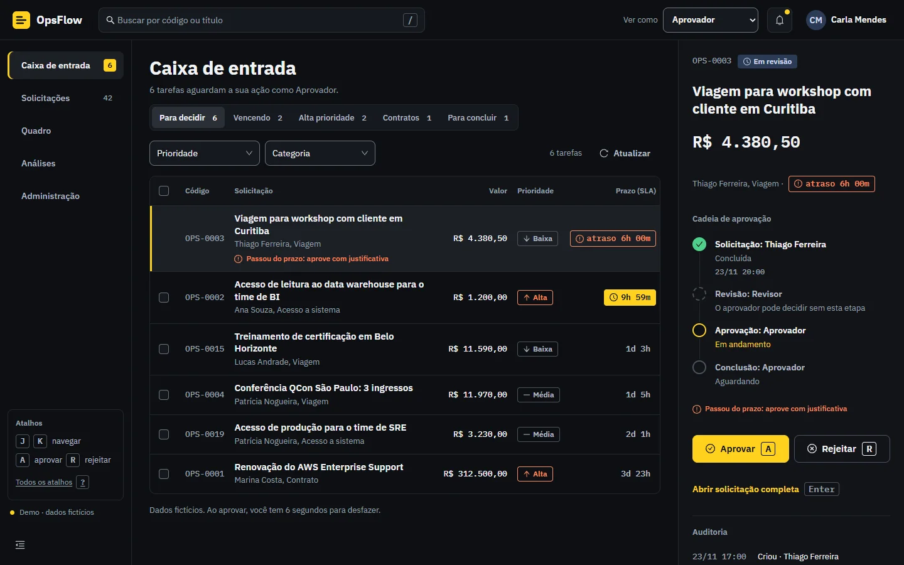


  

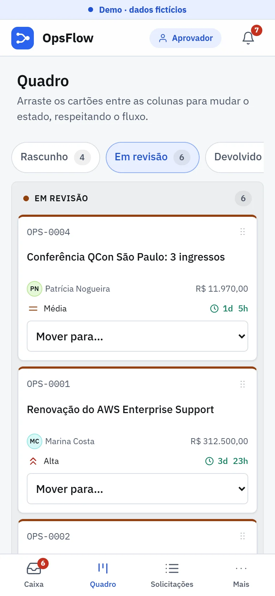   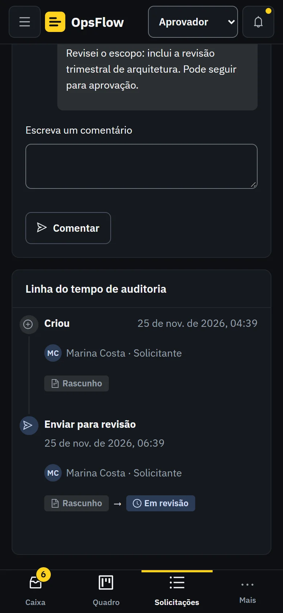

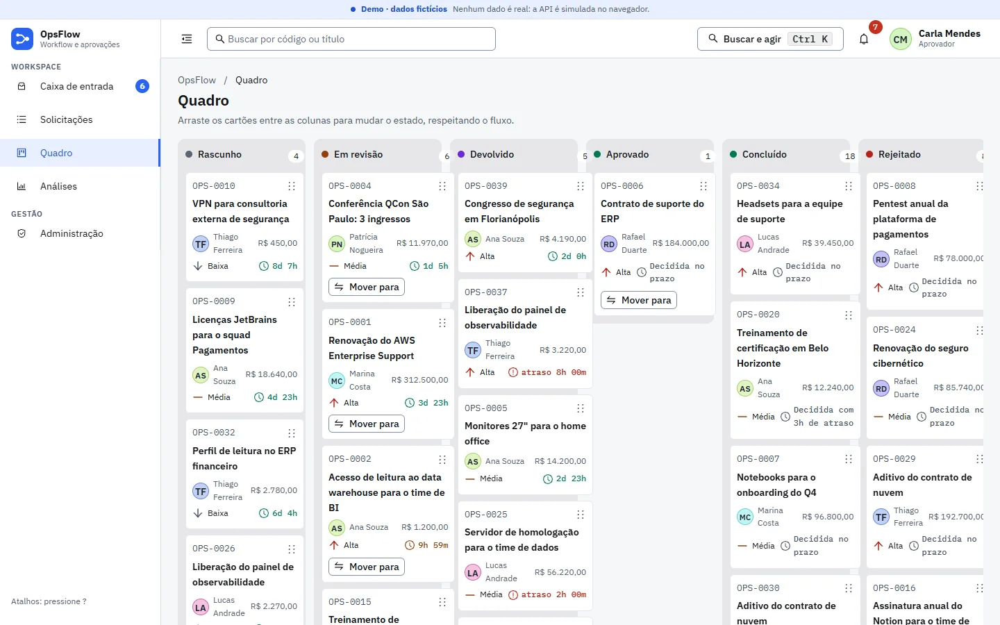

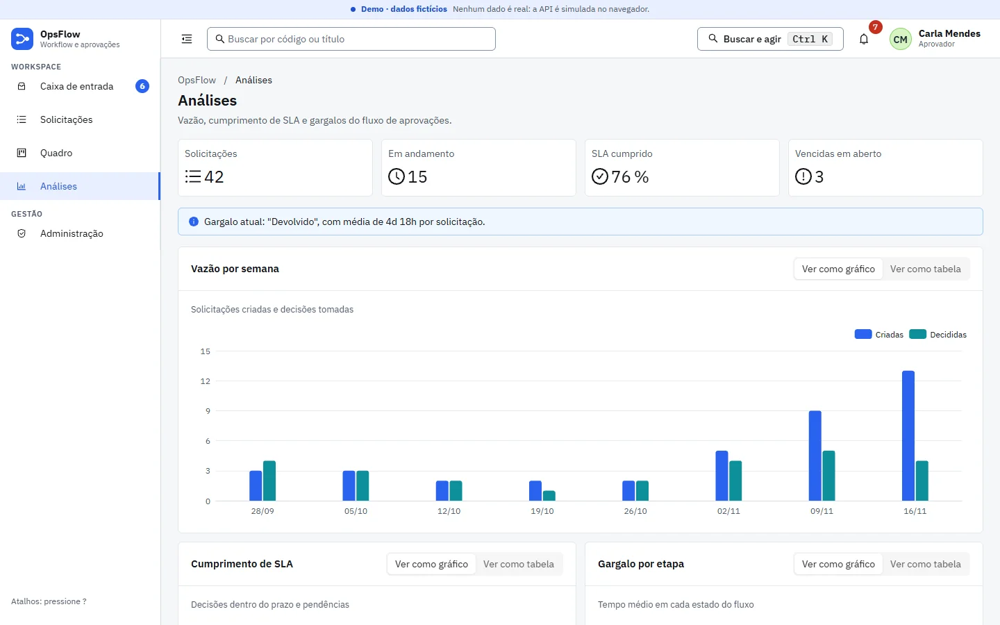


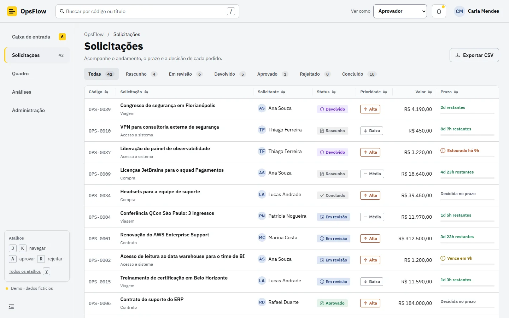

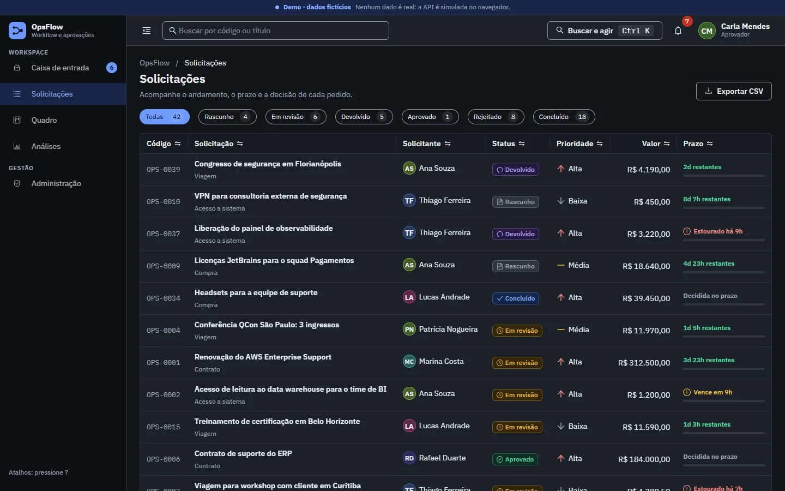

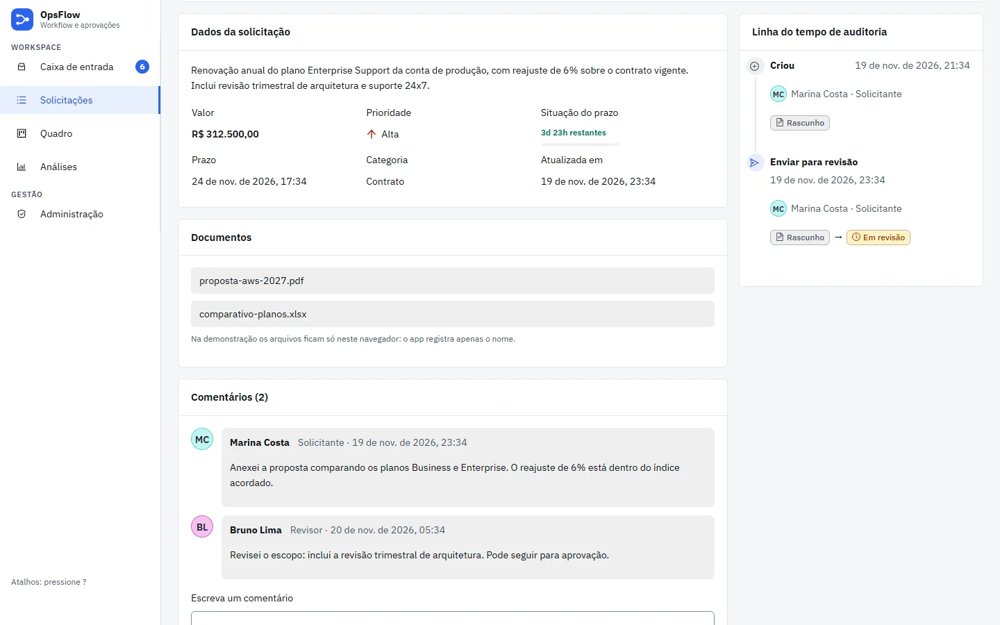

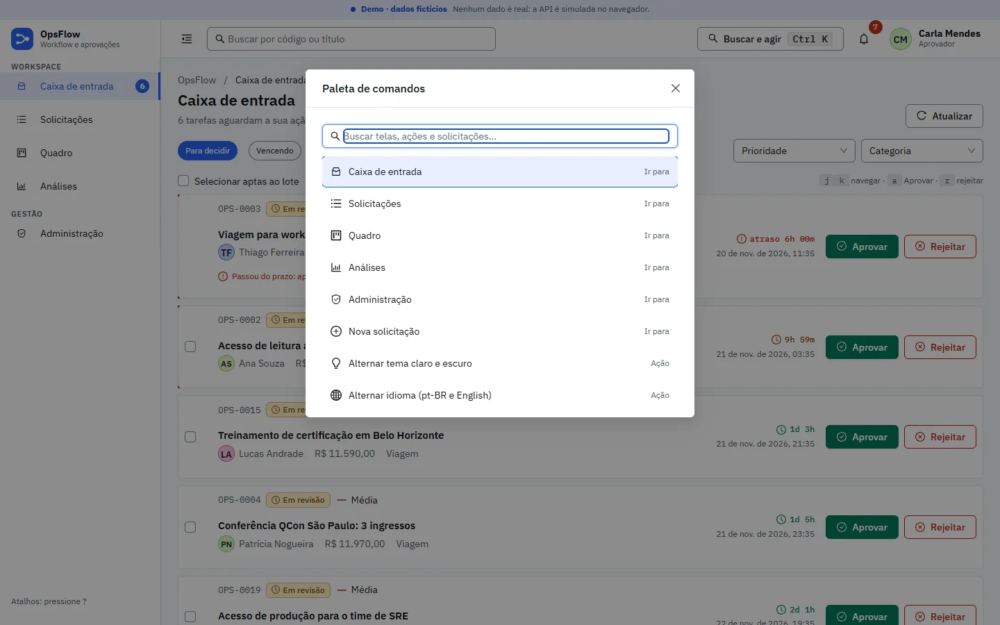

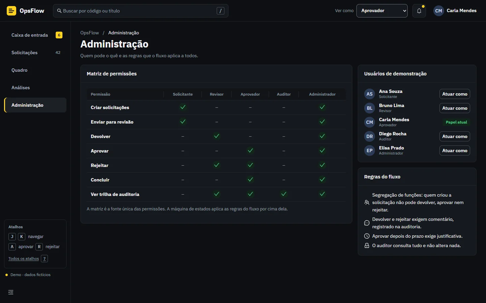


## O que o produto faz

- **Caixa de entrada por papel.** Tabela densa (linhas de 56 px) com código, solicitação, valor, prioridade e prazo de SLA (amarelo preenchido perto de vencer, borda laranja vencido), recortes com contagem, filtros salvos e atalhos `j`/`k`, `Enter`, `x`, `a`, `r`. A tarefa em foco aparece no painel de detalhe à direita (no celular, abaixo da tabela) com valor, cadeia de aprovação, as ações do papel com o atalho visível e as últimas entradas da auditoria. Decidir **resolve a tarefa**: ela sai da caixa na hora, o contador e o selo caem, o SLA congela ("Decidida no prazo" ou "com 5h de atraso") e um aviso oferece **Desfazer** por 6 segundos (a decisão só é confirmada na API depois dessa janela). O que foi aprovado e falta concluir aparece no filtro "Para concluir".
- **Aprovação em lote.** Barra amarela com quantidade e total em mono. A seleção é congelada no clique, as chamadas rodam em paralelo com "Aprovando 3 de 8…" e barra de progresso, e o resultado lista o que foi pulado e por quê (item que passou do prazo no meio do caminho vira "pulado", sem abrir diálogo).
- **Quadro kanban.** Arrastar com CDK DragDrop. Colunas que aceitam o movimento acendem durante o arraste; um movimento que a máquina de estados não prevê, ou que o papel não pode fazer, é bloqueado com explicação. Alternativa sem mouse: menu "Mover para" em cada cartão.
- **Detalhe.** Cabeçalho com status e SLA, cadeia de aprovação em **Steps** (solicitação, revisão, aprovação, conclusão), ações conforme o papel, comentários em thread, anexos simulados e **Timeline** de auditoria.
- **Nova solicitação.** Wizard em três etapas (**Steps**) com formulário reativo validado, **rascunho salvo automaticamente** (recuperado ao recarregar) e revisão antes de enviar.
- **Análises.** Vazão por semana, cumprimento de SLA, gargalo por etapa e ações por papel, em ECharts. Todo gráfico tem versão em tabela e descrição para leitor de tela.
- **Administração.** Matriz de permissões (RBAC) em tabela, usuários de demonstração (atuar como) e as regras do fluxo.
- **Lista de solicitações.** Tabela com ordenação por coluna, filtros por status com contadores, paginação, busca com debounce e exportação em CSV (com proteção contra injeção de fórmula). No celular vira lista de cartões.
- **Navegação de app.** Barra superior com busca (atalho `/`), seletor "Ver como" (papel de demonstração), notificações e perfil; menu lateral de 210 px recolhível, com contadores em selos mono e a caixa de atalhos no rodapé; e trilha de navegação em cada tela. No celular, o menu vira gaveta e há barra inferior com Caixa, Quadro (ou Nova, para o Solicitante), Solicitações e **Mais** (Análises, Administração, Nova solicitação, paleta, atalhos e perfil). Paleta de comandos (`Ctrl`/`⌘` + `K`), modal de atalhos (`?`) e estado na URL (rota por hash).
- **Preferências.** Papel, idioma (pt-BR e English, com plural correto), tema claro e escuro, densidade compacta ou confortável e "Simular falhas da API".

## Atalhos

| Tecla | Ação |
|---|---|
| `Ctrl`/`⌘` + `K` | Paleta de comandos |
| `?` | Lista de atalhos |
| `/` | Ir para a busca |
| `g` `i` / `g` `r` / `g` `b` / `g` `a` | Caixa de entrada / solicitações / quadro / análises |
| `j` `k` | Próxima e anterior tarefa (caixa de entrada) |
| `Enter` / `x` / `a` / `r` | Abrir / selecionar para lote / aprovar / rejeitar ou devolver |

## Stack

Angular 22 (standalone, signals, zoneless, control flow `@if/@for`), **NG-ZORRO 22.2.0** (Ant Design) com tema em Less, **ngx-echarts 22.0.0** sobre **Apache ECharts 6.1.0** (registro enxuto em `echarts/core`, renderer SVG), formulários reativos tipados, RxJS (busca com debounce e cancelamento via `switchMap`), Angular CDK (`DragDrop`, `LiveAnnouncer`, `BreakpointObserver`), SCSS, Vitest, Playwright + axe-core e **Storybook 10** (`@storybook/angular`) com o addon de acessibilidade.

A escolha de versões está no [ADR 0001](docs/adr/0001-ui-ng-zorro-echarts.md): o NG-ZORRO 22.2.0 declara peers `@angular/* ^22.0.0`, então o Angular 22.3.0 do projeto ficou como estava (sem `ng update` nem downgrade).

### Dependências e licenças

Versões exatas no `package.json` (sem `^` nem `~`). Licenças conferidas em `node_modules` e com `npm view`.

| Pacote | Versão | Licença | Uso |
|---|---|---|---|
| `ng-zorro-antd` | 22.2.0 | MIT | componentes (só dentro de `src/app/ui`) |
| `@ant-design/icons-angular` | 22.1.1 | MIT | ícones (dependência do NG-ZORRO; só os usados são registrados) |
| `echarts` | 6.1.0 | Apache-2.0 | gráficos |
| `zrender` | 6.1.0 | BSD-3-Clause | motor de desenho do ECharts (transitiva) |
| `ngx-echarts` | 22.0.0 | MIT | integração do ECharts com Angular |
| `@angular/*` (core, common, forms, router, platform-browser, compiler, cdk) | 22.3.0 | MIT | framework |
| `rxjs` | 7.8.2 | Apache-2.0 | reatividade |
| `tslib` | 2.9.1 | 0BSD | helpers do TypeScript |
| `@fontsource/ibm-plex-sans`, `@fontsource/ibm-plex-mono` | 5.3.0 | OFL-1.1 | fontes auto-hospedadas (já eram usadas antes) |
| `storybook`, `@storybook/angular`, `@storybook/addon-a11y`, `@storybook/addon-docs` | 10.6.8 | MIT | Storybook (dev) |
| `@angular-devkit/build-angular`, `@angular/platform-browser-dynamic`, `@angular/animations`, `zone.js` | 22.3.0 / 22.3.0 / 22.3.0 / 0.16.3 | MIT | exigidos pelo `@storybook/angular` (dev) |
| `less` | 4.9.1 | Apache-2.0 | compila o tema do NG-ZORRO (dev) |
| `@axe-core/playwright` | 4.14.0 | MPL-2.0 | axe nos testes E2E (dev; já era usado antes) |
| `@playwright/test`, `typescript`, `vitest`, `eslint`, `angular-eslint` e demais ferramentas | ver `package.json` | MIT ou Apache-2.0 | testes, tipos e lint (dev) |

Fora de "MIT ou Apache 2.0": as fontes (OFL-1.1, já existiam), `tslib` (0BSD), `zrender` (BSD-3-Clause, transitiva do ECharts) e o `axe-core` de testes (MPL-2.0, só desenvolvimento). Nenhuma é PrimeNG nem componente de licença restrita.

`npm audit --omit=dev`: **0 vulnerabilidades**. O `npm audit` completo aponta 5 (2 moderadas e 3 altas) em dependências **só de desenvolvimento** do builder do Storybook (`webpack-dev-middleware`, `minimatch`); não entram no que vai para produção.

## Camada de UI (`src/app/ui`)

As telas **nunca** importam `ng-zorro-antd`, `echarts`, `ngx-echarts` nem os ícones: só os wrappers `app-*`. Uma regra de lint (`no-restricted-imports`, em `eslint.config.mjs`) barra esses imports fora de `src/app/ui`. Cada wrapper é standalone, com `OnPush`, signals e uma story com os estados e controles (`*.stories.ts`, na mesma pasta).

Os inputs seguem o contrato de props dos wrappers React (`AppButton`: `variant`, `size`, `loading`, `disabled`, `icon`, `danger`):

| Wrapper | Inputs principais | NG-ZORRO |
|---|---|---|
| `app-button` | `variant` (`primary`/`default`/`dashed`/`text`/`link`), `size` (`small`/`middle`/`large`), `loading`, `disabled`, `icon`, `danger`, `block`, `tone` (`success`, extensão do OpsFlow), `htmlType` | Button |
| `app-icon-button` | `icon`, `label` (obrigatório), `variant`, `size`, `danger`, `loading`, `disabled` | Button |
| `app-icon` | `name`, `size` (rem), `spin`, `label` | Icon |
| `app-input` | `type` (`text`/`number`/`search`/`password`/`textarea`), `placeholder`, `maxlength`, `rows`, `invalid`, `prefixIcon`, `clearable` (CVA) | Input |
| `app-select` | `options`, `placeholder`, `allowClear`, `searchable`, `invalid`, `size`, `ariaLabel` (CVA) | Select |
| `app-checkbox`, `app-switch` | `ariaLabel`, `indeterminate` / `loading` (CVA) | Checkbox, Switch |
| `app-date-picker` | `showTime`, `invalid`, `placeholder` (CVA, valor `aaaa-mm-ddThh:mm`) | DatePicker |
| `app-form-item` | `label`, `forId`, `required`, `error`, `hint` | Form |
| `app-segmented` | `options`, `value`, `ariaLabel`, `block` | Segmented |
| `app-table` | `columns`, `data`, `loading`, `pageSize`, `sort`, `sortChange`; células por `ng-template appTableCell` | Table |
| `app-list`, `app-pagination` | `data`, `trackBy` / `total`, `pageSize`, `page` | List, Pagination |
| `app-card` | `title`, `bordered`, `hoverable`, `loading`, `size`, `flush` | Card |
| `app-statistic` | `title`, `value`, `suffix`, `icon`, `tone`, `loading`, `animated` | Statistic |
| `app-tag` | `tone`, `icon`, `checkable`, `checked` | Tag |
| `app-status` | `status`, `label` | Badge (status) |
| `app-avatar` | `name`, `size`, `src` | Avatar |
| `app-badge` | `count`, `dot`, `standalone`, `tone` | Badge |
| `app-progress` | `value`, `max`, `label`, `status`, `showInfo` | Progress |
| `app-descriptions` | `column`, `bordered`, `layout`; itens `app-descriptions-item` | Descriptions |
| `app-timeline` | `marks`, `data`; conteúdo por `ng-template` | Timeline |
| `app-steps` | `steps`, `current`, `direction`, `size` | Steps |
| `app-tabs` | `tabs`, `activeKey`, `type`, `size` | Tabs |
| `app-empty`, `app-skeleton`, `app-alert`, `app-result` | `title`/`description` / `rows`, `count`, `avatar` / `type`, `message`, `closable` / `status`, `title` | Empty, Skeleton, Alert, Result |
| `app-modal`, `app-drawer` | `open`, `title`, `width`, `footer` / `open`, `title`, `placement`, `width`, `height` | Modal, Drawer |
| `appTooltip`, `app-dropdown`, `app-menu`, `app-breadcrumb`, `app-bottom-nav` | `items`, `groups`, `selectedKey`, `collapsed` | Tooltip, Dropdown, Menu, Breadcrumb |
| `app-layout`, `app-page-header` | `collapsed`, `mobile` / `title`, `subtitle`, `breadcrumb` | Layout |
| `app-chart` | `option`, `height`, `ariaLabel` | ECharts (ngx-echarts) |
| `UiFeedback` + `app-feedback-host` | `show(texto, tipo, duração, ação?)` | Message |

### Tema central

- **Cores e formas:** `src/styles/tokens.scss` traz os tokens `--ops-*` do pacote de design e os tokens semânticos `--ox-color-*` que wrappers e gráficos usam; `src/styles/overrides-dark.less` e `overrides-light.less` levam os mesmos valores às variáveis do NG-ZORRO (primário `#FFD21F` com texto `#0D0F12`, cantos de 8 px e 4 px nos selos, IBM Plex). Fontes auto-hospedadas (`@fontsource`).
- **Escuro por padrão, claro por escolha:** a folha escura do NG-ZORRO vem no bundle; a clara (`theme-light.css`, gerada por `scripts/build-theme-light.mjs`) só é baixada quando o tema claro é escolhido, e o `UiTheme` a liga e desliga. A escolha é lembrada.
- **Densidade:** compacta (padrão) ou confortável. Os wrappers mudam o tamanho dos controles (`middle` ou `large`) a partir do `UiTheme`.
- **Contraste AA calculado:** o teste `theme-contrast.spec.ts` calcula a razão de cada par texto/fundo (mínimo 4,5:1) e de cada par de componente ou gráfico (mínimo 3:1) nos dois temas, e confere que as variáveis do NG-ZORRO batem com os tokens. O amarelo `#FFD21F` só aparece como fundo, com texto `#0D0F12` (13,2:1); no tema claro, amarelo como texto ou traço vira `#8A6A00` (5,07:1 sobre branco), e o laranja de atraso vira `#A8441A` para passar em AA sobre o fundo rosado.

## Storybook

```bash
npm run storybook        # http://localhost:6006
npm run build-storybook  # storybook-static/ (roda no CI)
```

Há **129 stories em 39 arquivos** (uma ou mais por wrapper, ao lado do componente), com controles (`args`) nas props mais usadas e os estados que fazem sentido: padrão, desabilitado, carregando, erro e vazio. Rodei as 129 no build estático: todas renderizam sem erro e passam no axe (WCAG 2.1 AA).

O Storybook usa o tema escuro padrão do app (tokens, fontes e folha escura do NG-ZORRO) e o addon de acessibilidade (`@storybook/addon-a11y`).

## Arquitetura

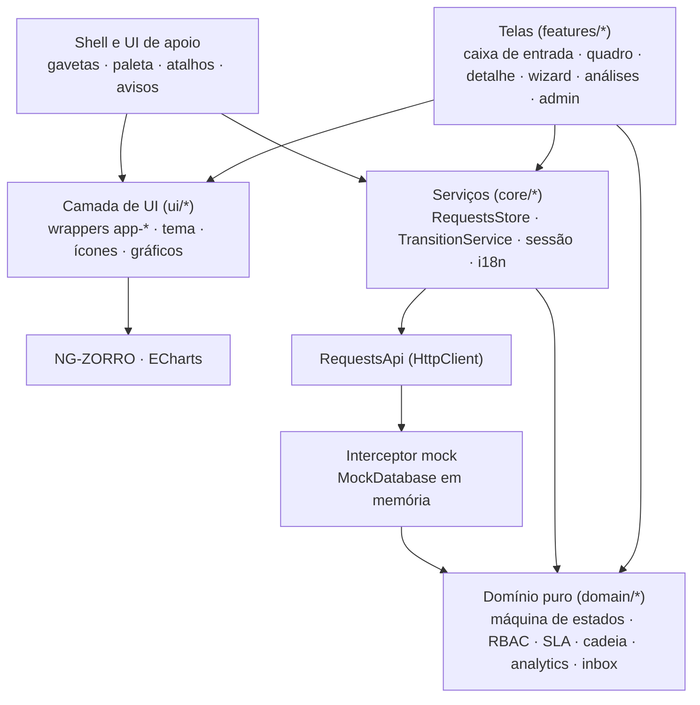

O domínio é feito só de funções puras e testadas (`src/app/domain`) e **não mudou** nesta refatoração. A interface nunca decide uma regra: ela pergunta ao domínio (`availableActions`, `checkTransition`, `requiresComment`) e o `TransitionService` é o único caminho para executar uma ação, seja pelo detalhe, pelo quadro ou pela caixa de entrada.

### Máquina de estados

```mermaid
stateDiagram-v2
  [*] --> draft
  draft --> in_review: submit (solicitante)
  in_review --> returned: return (revisor, comentário obrigatório)
  returned --> in_review: resubmit (solicitante)
  in_review --> approved: approve (aprovador; fora do SLA exige justificativa)
  in_review --> rejected: reject (revisor/aprovador, comentário obrigatório)
  approved --> completed: complete (aprovador/admin)
  rejected --> [*]
  completed --> [*]
```

Guardas: permissão do papel, estado de origem, segregação de funções (quem criou não devolve, aprova nem rejeita) e SLA.

### Matriz RBAC

| Permissão | Solicitante | Revisor | Aprovador | Auditor | Admin |
|---|:-:|:-:|:-:|:-:|:-:|
| request.create / submit | ✓ | | | | ✓ |
| request.return | | ✓ | | | ✓ |
| request.approve | | | ✓ | | ✓ |
| request.reject | | ✓ | ✓ | | ✓ |
| request.complete | | | ✓ | | ✓ |
| audit.view | | ✓ | ✓ | ✓ | ✓ |

Testada por tabela em `src/app/domain/permissions.spec.ts` e exibida na tela Administração.

### Migração de legado

`src/app/domain/legacy-adapter.ts` converte o JSON do sistema antigo (`STATUS_CD`, datas `dd/mm/aaaa`, valores `1.234,56`) para o domínio novo, validando cada campo e registrando a migração na auditoria.

## Segurança e limites da demonstração

O RBAC e a validação **são aplicados na API simulada**, não só na tela: o ator vai nos cabeçalhos de cada chamada e o servidor filtra o que o Solicitante vê (só as próprias solicitações), remove a trilha de auditoria de quem não tem `audit.view`, recusa criar, enviar, comentar ou anexar sem permissão (403), valida todo corpo de entrada (422), só aceita anexos em rascunho ou devolvida e detecta conflito por status **e** versão (`updatedAt`), inclusive o caso A-B-A. Mesmo assim isto é uma demonstração: num produto real essas regras precisam viver no servidor, com autenticação.

## Decisões

1. **Cache único de solicitações (`RequestsStore`).** Caixa de entrada, quadro, análises, notificações e paleta leem do mesmo signal; uma ação em qualquer tela atualiza todas.
2. **Uma porta para executar ações (`TransitionService`).** Valida no domínio, pede o comentário obrigatório num diálogo, chama a API, atualiza o cache e avisa o usuário. Evita três implementações divergentes da mesma regra.
3. **Visões derivadas, não novos estados.** Cadeia de aprovação, notificações, caixa de entrada e análises são calculadas a partir da trilha de auditoria. O domínio e a máquina de estados não mudaram.
4. **UI só por wrappers.** NG-ZORRO e ECharts ficam atrás de `src/app/ui`, com lint que barra o import direto. Trocar de biblioteca, ou manter o contrato igual ao dos apps React, mexe numa pasta só.
5. **Tema por Less, com contraste testado.** O NG-ZORRO 22 é o Ant Design v4 (Less, sem `ConfigProvider`). As cores vivem em `overrides-*.less` e `tokens.scss`, e um teste confere o contraste e a coerência entre os dois.
6. **Rota por hash e build portátil.** O mesmo artefato funciona em `/opsflow/` (Pages) e em qualquer subcaminho do portfólio.
7. **Entradas do navegador não são confiáveis.** Rascunho do wizard e filtros salvos são validados campo a campo antes de usar; CSV neutraliza fórmulas; nomes de anexo são saneados.
8. **Plural no dicionário.** Textos usam `{count, plural, one {…} other {…}}` em vez de "item(ns)".
9. **Desfazer como janela de graça.** A máquina de estados não tem transição inversa, então "desfazer" não inventa uma: a decisão é aplicada na tela e só enviada depois de 6 segundos; desfazer cancela o envio. Se outra ação mexe na mesma solicitação antes disso, a pendente é confirmada primeiro.
10. **Cadeia de aprovação honesta.** Só a etapa atual fica "Em andamento". A revisão é **opcional** (o aprovador pode decidir sem ela) e a interface diz isso.
11. **Enviar é do dono.** Enviar e reenviar exigem ser o criador da solicitação (o administrador pode agir em nome dele, regra explícita e testada).
12. **Gráficos em ECharts, no chunk das análises.** O registro enxuto (barras, linha, pizza, grade, tooltip, legenda, SVG) mora dentro do `app-chart`; o ECharts não entra no bundle inicial.

## Acessibilidade

- Meta WCAG 2.2 AA. O E2E roda o **axe-core** em 7 telas, nos dois temas e em 360 e 1440 px (28 verificações), mais 6 diálogos e gavetas (paleta, atalhos, comentário obrigatório, notificações, perfil e a folha "Mais" do celular) nos mesmos temas e larguras, e exige zero violações.
- A geometria de cada diálogo e gaveta é verificada: a caixa cabe inteira na janela (360 e 1440 px).
- Link "Pular para o conteúdo", landmarks, títulos em ordem, rótulos em todos os campos e erros ligados ao campo (`aria-describedby`).
- Teclado em tudo: foco sempre visível, diálogos com foco preso, `Esc` fecha e o foco volta a quem abriu. A ordenação da tabela é por botão no cabeçalho.
- Cor nunca é o único sinal: status levam texto e ícone, SLA leva ícone e texto, prioridade leva ícone.
- Alvos de 44 px no celular (teste E2E mede os botões e a barra inferior).
- Sem rolagem horizontal da página em 320, 375, 390, 768, 1024, 1280, 1440 e 1920 px, nos dois temas e nas 7 telas (teste E2E); tabelas largas rolam dentro da própria caixa.
- `prefers-reduced-motion` desliga animações e contadores.
- Regiões vivas (`LiveAnnouncer` e avisos) para resultados assíncronos.

## Testes

- **331 testes unitários** (Vitest, 21 arquivos): máquina de estados, RBAC, SLA, auditoria, migração de legado, cadeia de aprovação (agora em Steps), caixa de entrada, notificações, análises, ordenação, filtros, CSV, rascunho, plural, paridade dos dicionários pt-BR e en (inclui varredura das chaves usadas nos templates) e o **contraste calculado do tema** (`theme-contrast.spec.ts`). O domínio e os testes dele não mudaram; no redesign o contraste ganhou pares novos (texto suave, superfície elevada, amarelo como texto) e o teste de componente da caixa de entrada passou a decidir pelo painel de detalhe.
- **95 testes E2E** (Playwright + axe) contra o build portátil servido em `/projetos/opsflow/`:
  - sem rolagem horizontal da página nas 7 telas, em 8 larguras (320 a 1920 px) e nos dois temas (16 testes);
  - axe com zero violações e sem rolagem horizontal em 7 telas, nos dois temas, em 360 e 1440 px (28 testes), e sem erro no console;
  - axe e geometria de 6 diálogos e gavetas (11 combinações por tema e largura): a caixa do painel cabe na janela;
  - aprovar da caixa de entrada, desfazer, justificativa fora do prazo, comentário obrigatório, `Esc` devolvendo o foco, lote com progresso, atalhos `j`/`k`/`a`, arrastar no quadro (transição inválida bloqueada) e "Mover para", segregação de funções, auditor somente leitura, comentários, rascunho do wizard, validação e criação pelo wizard (com o seletor de data), paleta, recarregar em rota interna, inglês, menu lateral recolhido, tema escuro como padrão (e a folha clara baixada só ao escolher o claro) e a barra inferior e a gaveta do celular, com alvos de 44 px.

## Desempenho

Antes (design feito à mão, gráficos em SVG próprio) e depois (NG-ZORRO + ECharts), no build portátil de produção:

| | Antes (design à mão) | Depois (1ª entrega NG-ZORRO) | Depois (otimizado) | Redesign "torre de controle" |
|---|---|---|---|---|
| Inicial (JS + CSS), bruto | 495 kB | 1,94 MB | 1,29 MB | **1,32 MB** |
| Inicial, transferido | 127 kB | 326 kB | 249 kB | **252 kB** |
| JS inicial (bruto / transferido) | 495 kB / 127 kB | 1,03 MB / 243 kB | 838 kB / 206 kB | 848 kB / 208 kB |
| CSS inicial (transferido) | embutido nos componentes | 40 + 40 + 3 kB (os dois temas) | 39 + 3 kB (só o claro) | 40 + 4 kB (só o escuro, que é o padrão) |
| Tema não padrão | embutido | baixado junto, sempre | `theme-dark.css` (40 kB), só ao usar o escuro | `theme-light.css` (≈40 kB), só ao usar o claro |
| Maior bloco sob demanda | 68 kB (quadro) | 611 kB (análises, com o ECharts) | igual | igual |

No redesign, o seletor "Ver como" da barra superior é um `<select>` nativo estilizado: com o Select do NG-ZORRO ele puxava o componente para o bundle inicial (262 kB transferidos); com o nativo o inicial ficou em 252 kB.

O que mudou na otimização: (1) a folha do tema escuro deixou de ser baixada com a página: é compilada por `scripts/build-theme-dark.mjs` para `public/theme-dark.css` e entra por um `<link>` só quando o tema escuro é ativado (ou quando o tema salvo já é o escuro); (2) gavetas, paleta, atalhos e pedido de comentário (com o Modal, a Lista, o Form e o Empty do NG-ZORRO) viraram um bloco `@defer` carregado na primeira abertura, com `prefetch on idle`; (3) o adaptador de datas (date-fns) só entra com a rota do wizard. Conferi com `--stats-json` que `table`, `date-picker`, `steps`, `timeline` e `descriptions` já estavam fora do bundle inicial; os ícones registrados são só os usados.

O "antes" é o número medido na versão anterior (bundle inicial de 495 kB, 127 kB transferidos). O "depois" vem do `ng build --configuration portable`, estimativa de transferência do próprio Angular CLI.

O que sobra no bundle inicial é, sobretudo, Angular (core, router, forms), CDK, menu, input e ícones do NG-ZORRO e o dicionário de textos. Cada tela é carregada sob demanda e o ECharts só entra no chunk das análises.

## Como rodar

```bash
npm ci
npm start               # http://localhost:4200
npx ng test             # testes unitários (Vitest)
npm run lint            # ESLint (inclui a barreira de imports da UI)
npm run build
npm run theme:light     # gera public/theme-light.css (roda sozinho antes de start/build)
npm run build:portable  # dist-portable/ (base ./, rota por hash, nomes com hash)
npm run build-storybook # storybook-static/
npm run e2e             # Playwright + axe (usa o Chrome instalado e o build portátil; E2E_PORT muda a porta)
```

### Build portátil (qualquer subcaminho)

`npm run build:portable` gera `dist-portable/` com caminhos relativos e roteamento por hash, então funciona servido em qualquer subcaminho, por exemplo `/projetos/opsflow/`. O deploy do Pages continua usando `--base-href /opsflow/`. O E2E serve exatamente essa pasta num subcaminho para provar isso.

## O que ficou de fora

- Estado dos filtros da caixa de entrada e da lista na URL (hoje só a rota fica na URL; filtros salvos ficam no navegador).
- Desfazer depois da janela de 6 s: dentro dela a decisão é adiada e pode ser cancelada; depois disso não há transição inversa na máquina de estados.
- Anexos reais: são simulados (só o nome do arquivo é registrado).
- Alternância de tema no Storybook: ele carrega só a folha escura do NG-ZORRO.
- "Rejeitar" em lote: a barra de lote só aprova. Rejeitar exige comentário por solicitação, e um comentário único para várias seria uma regra nova de negócio.
- Teste de componente de todos os fluxos: há specs de componente para Caixa de entrada, Cadeia de aprovação e Contagem; o resto fica no E2E.
- O `public/theme-light.css` é gerado (`npm run theme:light`, rodado automaticamente antes de `start`, `build` e `build:portable`) e não é versionado.
- A segurança (papéis, validação, concorrência) vive na API simulada: é uma demonstração, não autenticação real.

## Licença

MIT
