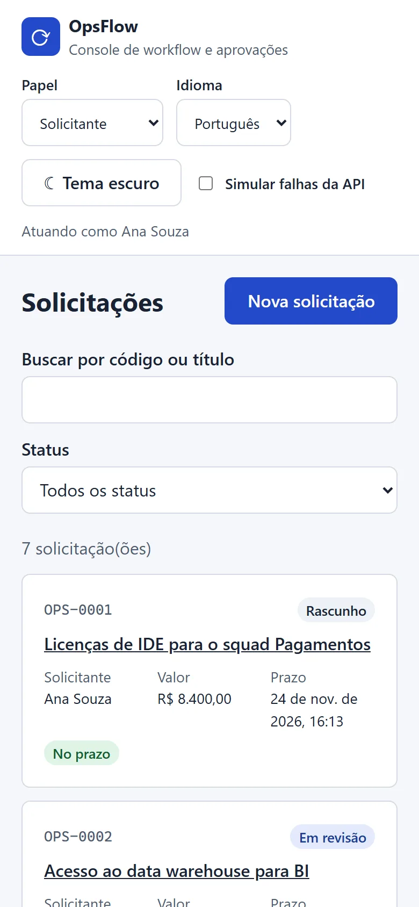

# OpsFlow · Enterprise Workflow & Approval Console

Console de workflow com etapas rastreáveis, permissões por papel, trilha de auditoria imutável e suporte multilíngue (pt-BR/en). Dados 100% fictícios; a API é simulada no navegador.

## Telas

Capturas em desktop (1440x900) e celular (390x844), com os dados fictícios de exemplo.


 

## Stack

Angular 22 (standalone, signals, zoneless, control flow `@if/@for`), formulários reativos tipados, RxJS (busca com debounce e cancelamento via `switchMap`), Angular CDK (`LiveAnnouncer`), Vitest.

## Máquina de estados

```mermaid
stateDiagram-v2
  [*] --> draft
  draft --> in_review: submit (solicitante)
  in_review --> returned: return (revisor, comentário obrigatório)
  returned --> in_review: resubmit (solicitante)
  in_review --> approved: approve (aprovador; fora do SLA exige justificativa)
  in_review --> rejected: reject (revisor/aprovador, comentário obrigatório)
  approved --> completed: complete (aprovador/admin)
  rejected --> [*]
  completed --> [*]
```



Guardas: permissão do papel, estado de origem, segregação de funções (quem criou não decide) e SLA.

## Matriz RBAC

| Permissão | Solicitante | Revisor | Aprovador | Auditor | Admin |
|---|:-:|:-:|:-:|:-:|:-:|
| request.create / submit | ✓ | | | | ✓ |
| request.return | | ✓ | | | ✓ |
| request.approve | | | ✓ | | ✓ |
| request.reject | | ✓ | ✓ | | ✓ |
| request.complete | | | ✓ | | ✓ |
| audit.view | | ✓ | ✓ | ✓ | ✓ |

Testada por tabela em `src/app/domain/permissions.spec.ts`.

## Migração de legado

`src/app/domain/legacy-adapter.ts` converte o JSON do sistema antigo (`STATUS_CD`, datas `dd/mm/aaaa`, valores `1.234,56`) para o domínio novo, validando cada campo e registrando a migração na auditoria.

## Como rodar

```bash
npm ci
npm start        # http://localhost:4200
npx ng test      # testes unitários (Vitest)
npm run build
npm run lint     # ESLint (angular-eslint, configuração flat)
```

### Build portátil (qualquer subcaminho)

```bash
npm run build:portable   # gera dist-portable/ (configuração "portable": base href ./)
```

A pasta usa caminhos relativos e roteamento por hash, então funciona servida em qualquer subcaminho,
por exemplo `/projetos/opsflow/`. O deploy do Pages continua usando `--base-href /opsflow/`.

## Licença

MIT
