# OpsFlow · A sala de controle das aprovações

Console de workflow e aprovações para quem decide o dia inteiro: cada papel abre o app na **caixa de entrada** das próprias tarefas, com SLA em contagem regressiva, aprovação em lote e atalhos de teclado. A demo abre como **Aprovador**, que é onde está o valor; o perfil troca o papel para ver o app como Solicitante, Revisor, Auditor ou Administrador. Por baixo há uma máquina de estados com permissões por papel, segregação de funções e trilha de auditoria imutável.

Todos os dados são fictícios e a API é simulada no navegador (interceptor HTTP), então o app roda inteiro em qualquer hospedagem estática.

**Demo:** https://nasckdev.github.io/opsflow/

## Telas

Desktop em 1440x900 e celular em 390x844, com os dados fictícios de exemplo.


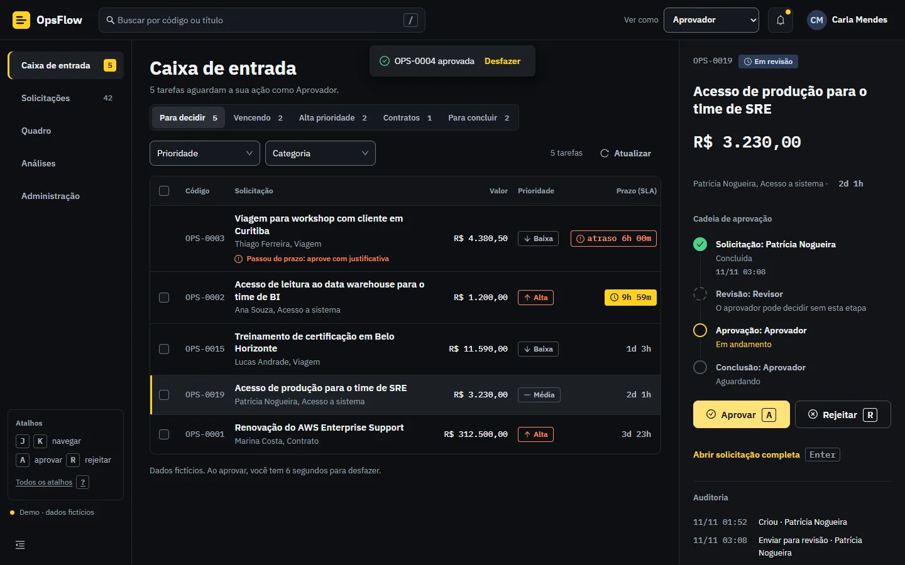

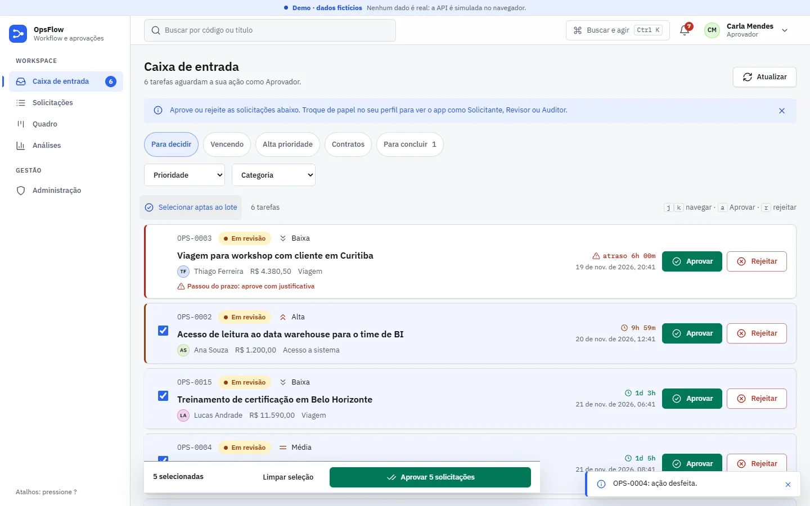

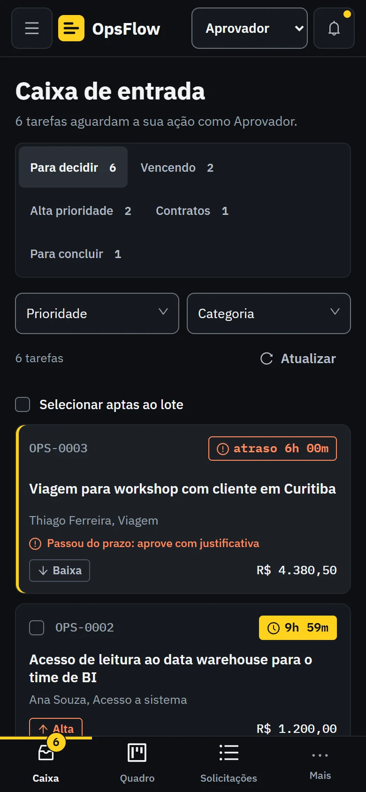 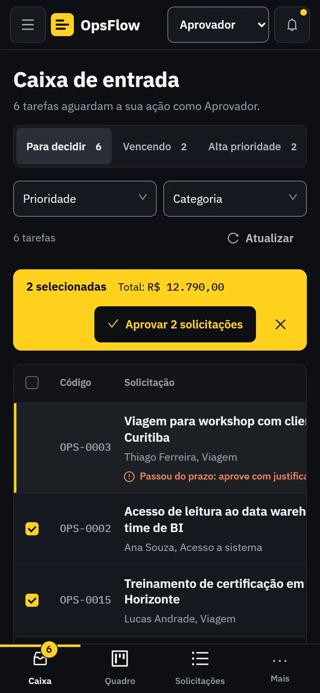 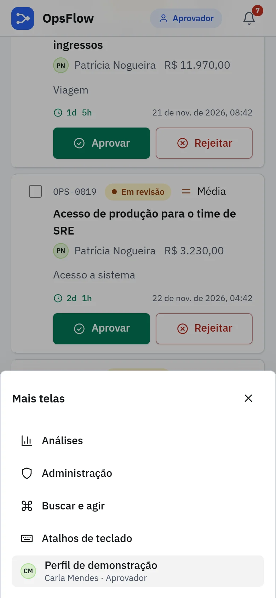

 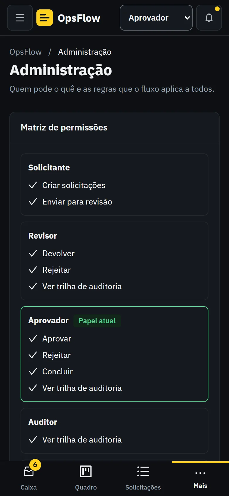  


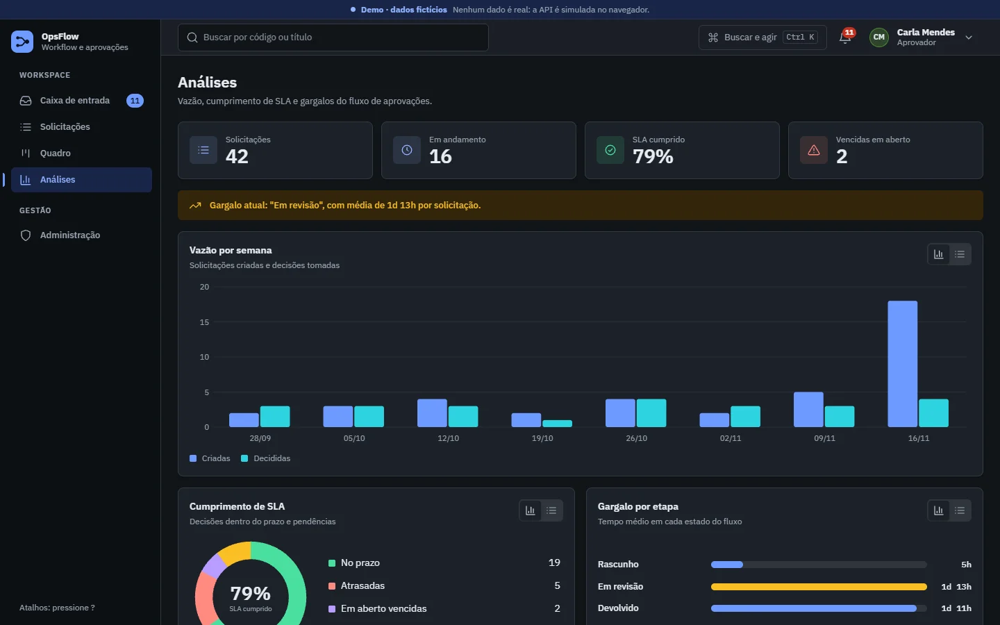


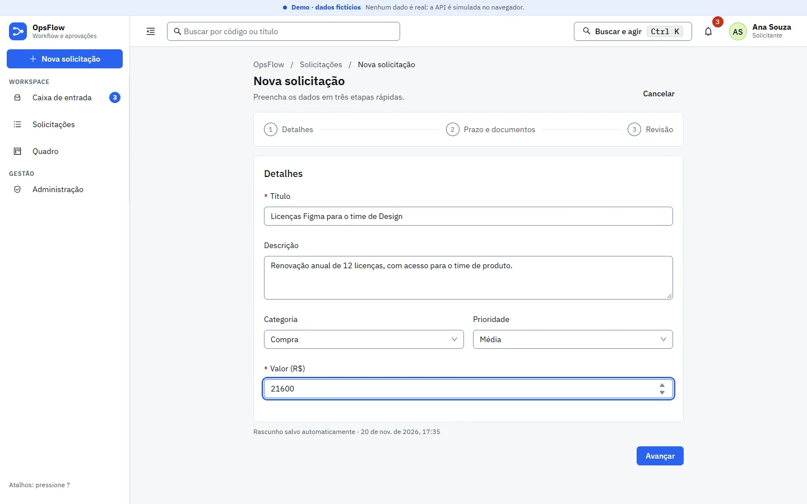

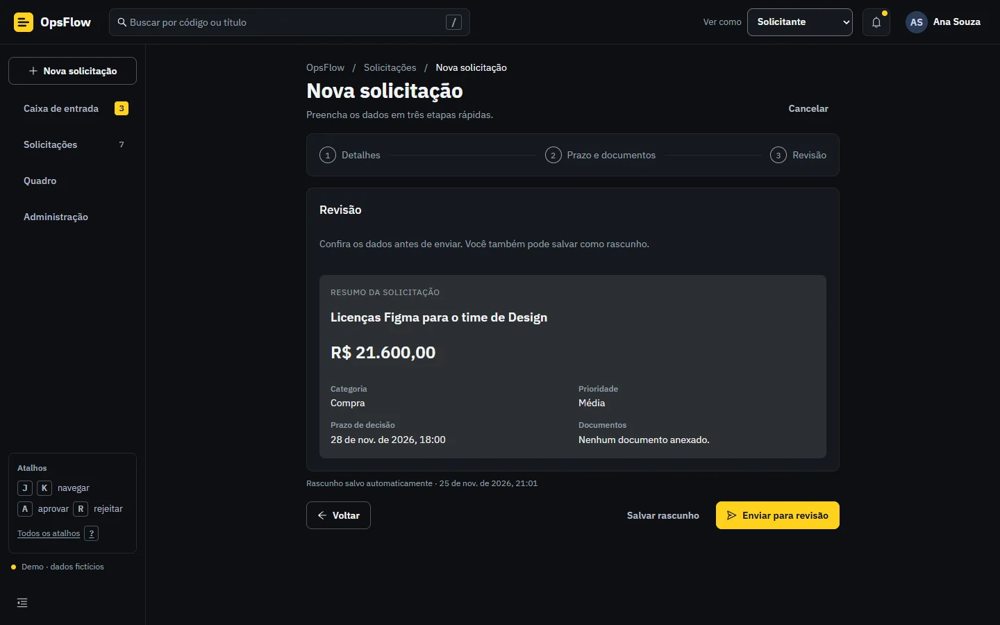

## O que o produto faz

- **Caixa de entrada por papel.** "Minhas tarefas" com contagem regressiva de SLA, filtros rápidos e salvos e atalhos `j`/`k`, `Enter`, `x`, `a`, `r`. Decidir **resolve a tarefa**: ela sai da caixa na hora, o contador e o selo caem, o SLA congela ("Decidida no prazo" ou "com 5h de atraso") e um aviso oferece **Desfazer** por 6 segundos (a decisão só é confirmada na API depois dessa janela). O que foi aprovado e falta concluir aparece no filtro "Para concluir".
- **Aprovação em lote.** A seleção é congelada no clique, as chamadas rodam em paralelo com "Aprovando 3 de 8…" e barra de progresso, e o resultado lista o que foi pulado e por quê (item que passou do prazo no meio do caminho vira "pulado", sem abrir diálogo).
- **Quadro kanban.** Arrastar com CDK DragDrop. Colunas que aceitam o movimento acendem durante o arraste; um movimento que a máquina de estados não prevê, ou que o papel não pode fazer, é bloqueado com explicação. Alternativa sem mouse: "Mover para" em cada cartão.
- **Detalhe.** Cabeçalho com status e SLA, cadeia de aprovação (solicitação, revisão, aprovação, conclusão), ações conforme o papel, comentários em thread, anexos simulados e linha do tempo de auditoria.
- **Nova solicitação.** Wizard em três etapas com validação, **rascunho salvo automaticamente** (recuperado ao recarregar) e revisão antes de enviar.
- **Análises.** Vazão por semana, cumprimento de SLA, gargalo por etapa e ações por papel. Todo gráfico tem versão em tabela e descrição para leitor de tela.
- **Administração.** Matriz de permissões visual, usuários de demonstração (atuar como) e as regras do fluxo.
- **Lista de solicitações.** Tabela densa (ordenação por coluna, contadores por status, busca com debounce) que vira cartões no celular, e exportação em CSV (com proteção contra injeção de fórmula).
- **Navegação de app.** Sidebar no desktop; no celular, barra inferior com Caixa, Quadro (ou Nova, para o Solicitante), Solicitações e **Mais** (Análises, Administração, Nova solicitação, paleta, atalhos e perfil), busca global, paleta de comandos (`Ctrl`/`⌘` + `K`), notificações, modal de atalhos (`?`) e estado na URL (rota por hash).
- **Preferências.** Papel, idioma (pt-BR e English, com plural correto), tema claro e escuro, densidade compacta ou confortável e "Simular falhas da API".

## Atalhos

| Tecla | Ação |
|---|---|
| `Ctrl`/`⌘` + `K` | Paleta de comandos |
| `?` | Lista de atalhos |
| `/` | Ir para a busca |
| `g` `i` / `g` `r` / `g` `b` / `g` `a` | Caixa de entrada / solicitações / quadro / análises |
| `j` `k` | Próxima e anterior tarefa (caixa de entrada) |
| `Enter` / `x` / `a` / `r` | Abrir / selecionar para lote / aprovar / rejeitar ou devolver |

## Identidade visual

IBM Plex Sans na interface e IBM Plex Mono em códigos, IDs e prazos, ambas auto-hospedadas via `@fontsource` (nenhuma requisição externa). Grafite `#111418` e aço `#1C2128` no escuro, azul elétrico `#2F6BFF` como marca e ciano de destaque. Estados com cor semântica e sempre acompanhados de texto ou ícone: aprovado esmeralda, pendente âmbar, devolvido violeta, rejeitado vermelho, rascunho cinza. Cantos de 4 a 8 px e densidade ajustável.

Os tokens vivem em `src/styles/tokens.scss`; as medidas do shell e os aliases de superfície, em `src/styles/base.scss`. No tema claro o ciano de gráficos é um tom mais escuro que o da marca, para manter 3:1 de contraste contra o fundo branco.

## Stack

Angular 22 (standalone, signals, zoneless, control flow `@if/@for`), formulários reativos tipados, RxJS (busca com debounce e cancelamento via `switchMap`), Angular CDK (`Overlay`, `Dialog`, `DragDrop`, `TrapFocus`, `LiveAnnouncer`), SCSS, Vitest e Playwright + axe-core. Gráficos em SVG próprio, sem biblioteca.

## Arquitetura

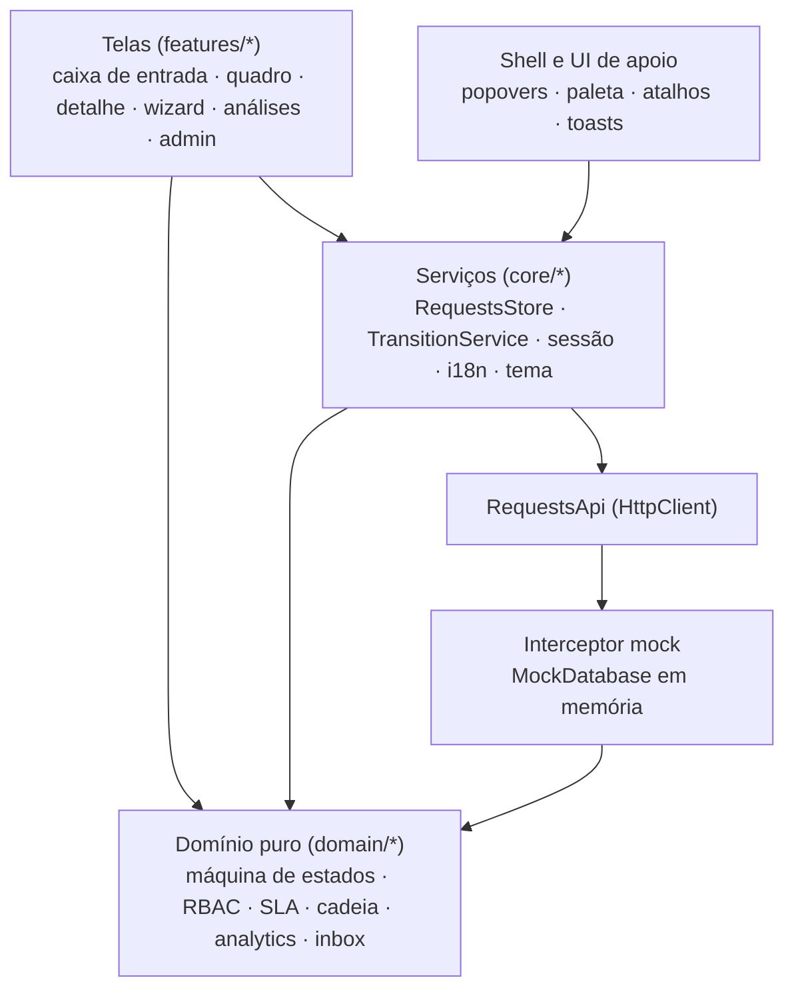

O domínio é feito só de funções puras e testadas (`src/app/domain`). A interface nunca decide uma regra: ela pergunta ao domínio (`availableActions`, `checkTransition`, `requiresComment`) e o `TransitionService` é o único caminho para executar uma ação, seja pelo detalhe, pelo quadro ou pela caixa de entrada.

### Máquina de estados

```mermaid
stateDiagram-v2
  [*] --> draft
  draft --> in_review: submit (solicitante)
  in_review --> returned: return (revisor, comentário obrigatório)
  returned --> in_review: resubmit (solicitante)
  in_review --> approved: approve (aprovador; fora do SLA exige justificativa)
  in_review --> rejected: reject (revisor/aprovador, comentário obrigatório)
  approved --> completed: complete (aprovador/admin)
  rejected --> [*]
  completed --> [*]
```

Guardas: permissão do papel, estado de origem, segregação de funções (quem criou não devolve, aprova nem rejeita) e SLA.

### Matriz RBAC

| Permissão | Solicitante | Revisor | Aprovador | Auditor | Admin |
|---|:-:|:-:|:-:|:-:|:-:|
| request.create / submit | ✓ | | | | ✓ |
| request.return | | ✓ | | | ✓ |
| request.approve | | | ✓ | | ✓ |
| request.reject | | ✓ | ✓ | | ✓ |
| request.complete | | | ✓ | | ✓ |
| audit.view | | ✓ | ✓ | ✓ | ✓ |

Testada por tabela em `src/app/domain/permissions.spec.ts` e exibida na tela Administração.

### Migração de legado

`src/app/domain/legacy-adapter.ts` converte o JSON do sistema antigo (`STATUS_CD`, datas `dd/mm/aaaa`, valores `1.234,56`) para o domínio novo, validando cada campo e registrando a migração na auditoria.

## Segurança e limites da demonstração

O RBAC e a validação **são aplicados na API simulada**, não só na tela: o ator vai nos cabeçalhos de cada chamada e o servidor filtra o que o Solicitante vê (só as próprias solicitações), remove a trilha de auditoria de quem não tem `audit.view`, recusa criar, enviar, comentar ou anexar sem permissão (403), valida todo corpo de entrada (422), só aceita anexos em rascunho ou devolvida e detecta conflito por status **e** versão (`updatedAt`), inclusive o caso A-B-A. Mesmo assim isto é uma demonstração: num produto real essas regras precisam viver no servidor, com autenticação de verdade, e o navegador nunca é fonte de confiança.

## Decisões

1. **Cache único de solicitações (`RequestsStore`).** Caixa de entrada, quadro, análises, notificações e paleta leem do mesmo signal; uma ação em qualquer tela atualiza todas.
2. **Uma porta para executar ações (`TransitionService`).** Valida no domínio, pede o comentário obrigatório num diálogo, chama a API, atualiza o cache e avisa o usuário. Evita três implementações divergentes da mesma regra.
3. **Visões derivadas, não novos estados.** Cadeia de aprovação, notificações, caixa de entrada e análises são calculadas a partir da trilha de auditoria. O domínio e a máquina de estados não mudaram.
4. **Gráficos em SVG próprio.** Controle total de cor, contraste, animação e acessibilidade, sem dependência pesada. Cada gráfico tem tabela equivalente.
5. **Rota por hash e build portátil.** O mesmo artefato funciona em `/opsflow/` (Pages) e em qualquer subcaminho do portfólio.
6. **Entradas do navegador não são confiáveis.** Rascunho do wizard e filtros salvos são validados campo a campo antes de usar; CSV neutraliza fórmulas; nomes de anexo são saneados.
7. **Plural no dicionário.** Textos usam `{count, plural, one {…} other {…}}` em vez de "item(ns)".
8. **Desfazer como janela de graça.** A máquina de estados não tem transição inversa, então "desfazer" não inventa uma: a decisão é aplicada na tela e só enviada depois de 6 segundos; desfazer cancela o envio. Se outra ação mexe na mesma solicitação antes disso, a pendente é confirmada primeiro.
9. **Cadeia de aprovação honesta.** Só a etapa atual fica "Em andamento". A revisão é **opcional** (o aprovador pode decidir sem ela) e a interface diz isso.
10. **Enviar é do dono.** Enviar e reenviar exigem ser o criador da solicitação (o administrador pode agir em nome dele, regra explícita e testada).

## Acessibilidade

- Meta WCAG 2.2 AA. O E2E roda o **axe-core** em 7 telas nos dois temas (14 verificações) e exige zero violações.
- Link "Pular para o conteúdo", landmarks, títulos em ordem, rótulos em todos os campos e erros ligados ao campo (`aria-describedby`).
- Teclado em tudo: foco sempre visível, diálogos com foco preso, `Esc` fecha e o foco volta a quem abriu.
- Cor nunca é o único sinal: status levam texto, SLA leva ícone e texto, prioridade leva ícone.
- Alvos de 44 px e `safe-area` no celular; sem rolagem horizontal da página.
- `prefers-reduced-motion` desliga animações e contadores.
- Regiões vivas (`LiveAnnouncer` e toasts) para resultados assíncronos.

## Testes

- **275 testes unitários** (Vitest, 20 arquivos): máquina de estados, RBAC, SLA, auditoria, migração de legado, cadeia de aprovação, caixa de entrada, notificações, análises, ordenação, filtros, CSV, rascunho, plural e paridade dos dicionários pt-BR e en (inclui varredura das chaves usadas nos templates).
- **52 testes E2E** (Playwright + axe) contra o build portátil servido em `/projetos/opsflow/`: axe nos dois temas, aprovar da caixa de entrada, comentário obrigatório, aprovação em lote, atalhos, arrastar no quadro (transição inválida bloqueada), segregação de funções, auditor somente leitura, comentários, rascunho do wizard, criação de solicitação, paleta, recarregar em rota interna e inglês.

## Desempenho

Bundle inicial: **495 kB** (127 kB transferidos). Cada tela é carregada sob demanda (o maior bloco é o quadro, com 68 kB, por causa do CDK DragDrop). Fontes em `woff2`, só o subconjunto latino.

## Como rodar

```bash
npm ci
npm start               # http://localhost:4200
npx ng test             # testes unitários (Vitest)
npm run lint            # ESLint (angular-eslint, configuração flat)
npm run build
npm run build:portable  # dist-portable/ (base ./, rota por hash)
npm run e2e             # Playwright + axe (usa o Chrome instalado e o build portátil)
```

### Build portátil (qualquer subcaminho)

`npm run build:portable` gera `dist-portable/` com caminhos relativos e roteamento por hash, então funciona servido em qualquer subcaminho, por exemplo `/projetos/opsflow/`. O deploy do Pages continua usando `--base-href /opsflow/`. O E2E serve exatamente essa pasta num subcaminho para provar isso.

## O que ficou de fora

- Estado dos filtros da caixa de entrada e da lista na URL (hoje só a rota fica na URL; filtros salvos ficam no navegador).
- Desfazer depois da janela de 6 s: dentro dela a decisão é adiada e pode ser cancelada; depois disso não há transição inversa na máquina de estados.
- Anexos reais: são simulados (só o nome do arquivo é registrado).
- Teste de componente de todos os fluxos: há specs de componente para Caixa de entrada, Cadeia de aprovação e Contagem, o resto fica no E2E.
- Erro do quadro perto do cartão arrastado (hoje é um aviso global) e telas de erro/vazio ainda duplicadas entre páginas.
- A segurança (papéis, validação, concorrência) vive na API simulada: é uma demonstração, não autenticação real.

## Licença

MIT
